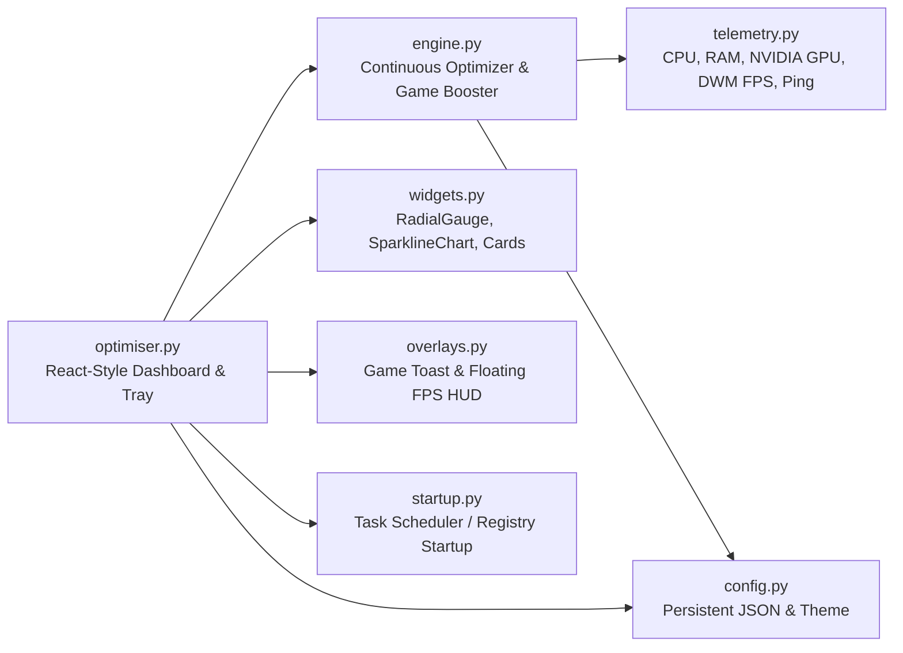

<div align="center">

# ⚡ Morbi Optimizer 2.5 Pro

**Windows için Gerçek Zamanlı Sistem Performans Motoru, Otomatik Oyun Modu, Canlı Bildirimler ve Özelleştirilebilir FPS HUD Widget**

[](https://www.python.org/)
[](#)
[](#)
[-10B981?style=for-the-badge)](#tek-exe-derleme-pyinstaller)
[](LICENSE)

<br />

> **React / Shadcn / Tailwind** esintili modern karanlık arayüzü, arka planda sürekli çalışan akıllı RAM ve süreç optimizasyon motoru, oyun başladığında ekranda beliren **canlı telemetri bildirim kartı** ve **ekran üstü FPS HUD widget'ı** ile sisteminizi her an maksimum performansta tutar.

</div>

---

## ✨ Öne Çıkan Özellikler

| Kategori | Özellikler |
| :--- | :--- |
| 🎨 **Modern Karanlık Arayüz** | `#090B10` obsidian tema, sol navigasyonlu 5 sayfalık dashboard, özel Canvas dairesel göstergeler (`RadialGauge`) ve 60 saniyelik canlı alan/çizgi grafikleri (`SparklineChart`). |
| 🚀 **Sürekli Optimizasyon Motoru** | RAM eşiği aşıldığında veya belirlenen periyotta (1 / 3 / 5 / 10 dk) `EmptyWorkingSet` ile arka plan belleğini otomatik temizler; oturum boyunca boşaltılan toplam MB'ı canlı takip eder. |
| 🎮 **Otomatik Oyun Modu** | **46+ yerleşik oyun** + özel `.exe` ekleme desteği. Oyun açıldığında CPU & I/O önceliğini `HIGH_PRIORITY_CLASS` yapar, **Yüksek / Ultra Performans güç planına** geçer, **1ms düşük gecikme zamanlayıcısını** (`timeBeginPeriod`) açar ve oyun kapanınca ayarları geri yükler. |
| 🔔 **Oyun Yakalandı Bildirimi** | Oyun başladığında ekran köşesinde açılan koyu cam tasarımlı bildirim kartı; oyun adı, PID, boşaltılan RAM ile **canlı FPS, CPU, RAM, GPU değerlerini** gösterir ve **12 saniye** (5–20 sn ayarlanabilir) sonunda yumuşakça kaybolur. |
| 📊 **Custom FPS & Performans HUD** | Her zaman üstte duran, sürüklenebilir, saydamlığı ayarlanabilir ekran üstü widget. **3 görünüm modu** (`Detaylı + Mini FPS Grafiği`, `Kompakt Bar`, `Minimal Sayaç`) ve Windows DWM üzerinden gerçek zamanlı FPS, Frametime (ms), 1% Low, Hz, CPU, RAM, NVIDIA GPU (°C/VRAM) ve Ping takibi. |
| 🧹 **Tek Tıkla Sistem Araçları** | `⚡ Turbo Boost`, manuel RAM boşaltma, `%TEMP%` temizleyici, DNS önbelleği sıfırlama (`ipconfig /flushdns`), Windows Güç Planı değiştirici ve en çok RAM kullanan süreçleri tek tek optimize etme yöneticisi. |
| 🛡 **Otomatik Yönetici & Başlangıç** | `--uac-admin` gömülü manifest ile tek `.exe` otomatik yönetici olarak başlar. Windows **Görev Zamanlayıcı (`/RL HIGHEST`)** entegrasyonu sayesinde bilgisayar açıldığında UAC engeline takılmadan sistem tepsisinde (`--minimized`) sessizce başlar. |

---

## 🧭 Arayüz Sayfaları

1. **⚡ Genel Bakış (`Dashboard`)**:
   - Üst aksiyon kartı (`Turbo Boost`, `RAM Temizle`, aktif güç planı, 1ms zamanlayıcı ve oyun modu rozetleri).
   - 4 adet canlı dairesel gösterge: **CPU** (`%`, MHz, çekirdek), **RAM** (`%`, GB), **GPU** (`%`, °C, VRAM), **Anlık FPS** (Frametime ms, Hz).
   - 60 saniyelik **Canlı Sistem Telemetrisi** (CPU/RAM/GPU) ve **Canlı FPS** grafikleri, Ağ/Disk I/O, Ping ve son optimizasyon günlüğü.
2. **🎮 Oyun Modu (`Game Booster`)**:
   - Aktif oyun durumu, **🔔 Oyun Bildirimini Test Et** butonu, tüm otomatik oyun optimizasyonu anahtarları ve özel `.exe` oyun kütüphanesi yöneticisi.
3. **📊 FPS & HUD Widget**:
   - Canlı FPS / Ortalama FPS / 1% Low / Frametime / Ekran Yenileme Hızı (Hz) analizi.
   - HUD aç/kapa, stil seçimi (`Detaylı`, `Kompakt`, `Minimal`), konum seçimi, saydamlık kaydırıcısı, konum kilidi ve metrik filtreleri.
4. **🚀 Performans & Temizlik**:
   - Sürekli optimizasyon ayarları (RAM eşiği `%55–%95`, periyodik temizlik aralığı), tek tık araçlar, Windows güç planı seçici ve canlı süreç yöneticisi.
5. **⚙ Ayarlar & Günlük**:
   - **Windows Başlangıcında Otomatik Başlat (Yönetici)** ve **Tepsiye Gizli Başlat** kontrolleri, bildirim süresi/konumu ayarları ve tam ekran optimizasyon günlüğü.

---

## 🏗 Mimari Yapı



### Dosya Yapısı

```text
optimiser/
├── optimiser.py            # Ana masaüstü uygulaması, 5 sayfalık dashboard ve sistem tepsisi
├── engine.py               # Sürekli RAM temizleme, oyun algılama, güç planı ve 1ms zamanlayıcı motoru
├── telemetry.py            # CPU, RAM, NVIDIA GPU (nvidia-smi), DWM FPS/Frametime, Disk/Ağ ve Ping toplayıcı
├── overlays.py             # Canlı Oyun Yakalandı bildirim kartı (Toast) ve ekran üstü FPS HUD widget'ı
├── widgets.py              # Özel Canvas RadialGauge, SparklineChart, GlassCard, PillBadge ve ToggleRow
├── startup.py              # Windows Görev Zamanlayıcı (/RL HIGHEST) ve Kayıt Defteri başlangıç yöneticisi
├── config.py               # Tema renk paleti, 46+ varsayılan oyun listesi ve kalıcı ayar yönetimi
├── morbi.ico               # Özel uygulama ikonu
├── MorbiOptimizerPro.spec  # PyInstaller tek dosya derleme yapılandırması
├── requirements.txt        # Python bağımlılıkları
└── LICENSE                 # MIT Lisansı
```

---

## 🛠 Kurulum ve Çalıştırma

### Gereksinimler
- **İşletim Sistemi:** Windows 10 veya Windows 11 (64-bit)
- **Python:** 3.10 veya üzeri (kaynak koddan çalıştırmak için)
- **GPU Telemetrisi:** NVIDIA ekran kartları için `nvidia-smi` otomatik algılanır (yoksa uygulama sorunsuz şekilde CPU/RAM/FPS ile çalışmaya devam eder)

### Kaynak Koddan Çalıştırma

```powershell
# 1. Depoyu klonlayın
git clone https://github.com/KULLANICI_ADINIZ/morbi-optimizer.git
cd morbi-optimizer

# 2. Bağımlılıkları yükleyin
pip install -r requirements.txt

# 3. Uygulamayı başlatın (Yönetici terminali önerilir)
python optimiser.py
```

> [!TIP]
> Uygulamayı doğrudan sistem tepsisinde sessizce başlatmak için `--minimized` parametresini kullanabilirsiniz:
> ```powershell
> python optimiser.py --minimized
> ```

---

## 📦 Tek EXE Derleme (PyInstaller)

Projeyi **otomatik yönetici yetkili (`--uac-admin`)**, konsolsuz ve tamamen bağımsız tek bir `.exe` dosyasına dönüştürmek için:

```powershell
pip install pyinstaller

python -m PyInstaller --noconfirm --clean --onefile --windowed --uac-admin `
  --name MorbiOptimizerPro `
  --icon morbi.ico `
  --collect-all customtkinter `
  --hidden-import pystray._win32 `
  --hidden-import PIL._tkinter_finder `
  optimiser.py
```

Derleme tamamlandığında tek dosya çıktısı `dist/MorbiOptimizerPro.exe` konumunda oluşturulur.

> [!NOTE]
> Tek `.exe` modunda kullanıcı ayarları otomatik olarak `%APPDATA%\MorbiOptimizer\morbi_config.json` dosyasında saklanır. Böylece `.exe` dosyasını dilediğiniz klasöre taşıyabilirsiniz.

---

## 🤝 Katkıda Bulunma

Katkılarınız memnuniyetle karşılanır!

1. Projeyi fork'layın
2. Yeni bir özellik dalı oluşturun (`git checkout -b feature/yeni-ozellik`)
3. Değişikliklerinizi commit edin (`git commit -m "feat: yeni özellik eklendi"`)
4. Dalınızı push edin (`git push origin feature/yeni-ozellik`)
5. Bir **Pull Request** açın

---

## 📄 Lisans

Bu proje **MIT Lisansı** altında lisanslanmıştır. Detaylar için [LICENSE](LICENSE) dosyasına göz atabilirsiniz.
