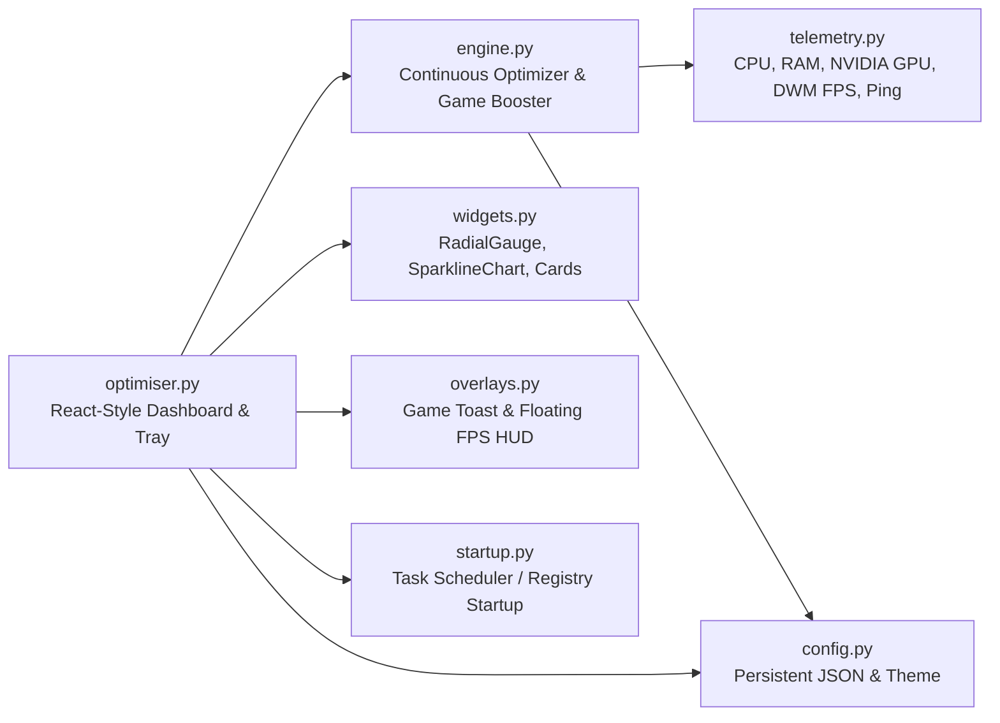

<div align="center">

# ⚡ Morbi Optimizer 2.5 Pro

**Real-Time Windows Performance Engine, Automatic Game Booster, Live Telemetry Notifications & Custom On-Screen FPS HUD**

[](https://www.python.org/)
[](#)
[](#)
[-10B981?style=for-the-badge)](#building-a-single-exe-pyinstaller)
[](LICENSE)

<br />

> A sleek **React / Shadcn / Tailwind-inspired** dark desktop dashboard featuring a continuous background RAM & process optimizer, automatic game detection with **live floating toast notifications**, and a **customizable on-screen FPS & hardware HUD widget**.

</div>

---

## ✨ Key Features

| Category | Capabilities |
| :--- | :--- |
| 🎨 **Modern Dark Dashboard** | `#090B10` obsidian dark theme, 5-page sidebar navigation, custom Canvas circular gauges (`RadialGauge`), and 60-second multi-series live area/line charts (`SparklineChart`). |
| 🚀 **Continuous Optimization Engine** | Automatically trims background working sets (`EmptyWorkingSet`) whenever RAM crosses your threshold or on a scheduled interval (1 / 3 / 5 / 10 min), tracking total freed MB per session. |
| 🎮 **Automatic Game Mode** | Supports **46+ built-in games** plus custom `.exe` entries. Automatically elevates CPU & I/O priority (`HIGH_PRIORITY_CLASS` / `IOPRIO_HIGH`), switches to **High / Ultimate Performance power plan**, activates a **1ms low-latency system timer** (`timeBeginPeriod`), throttles background bloat, and cleanly restores everything on exit. |
| 🔔 **Live Game Detected Toast** | A floating dark-glass notification banner appears automatically when a game launches—displaying game name, PID, freed RAM, optimization badges, and **live-updating FPS, CPU, RAM, and GPU metrics** before smoothly fading out after **12 seconds** (configurable 5–20s). |
| 📊 **Custom On-Screen FPS HUD** | Always-on-top, draggable, opacity-adjustable floating overlay with **3 layouts** (`Detailed + Live FPS Graph`, `Compact Bar`, `Minimal Counter`). Tracks real-time Windows DWM FPS, Frametime (ms), 1% Low, Monitor Hz, CPU, RAM, NVIDIA GPU (°C / VRAM), and Ping. |
| 🧹 **One-Click System Tools** | `⚡ Turbo Boost`, instant RAM cleaner, `%TEMP%` junk cleaner, DNS cache flush (`ipconfig /flushdns`), Windows Power Plan switcher, and a live top-RAM process manager. |
| 🛡 **Auto-Admin & Windows Startup** | Compiles into a standalone single `.exe` with an embedded `--uac-admin` (`requireAdministrator`) manifest. Integrates with **Windows Task Scheduler (`/RL HIGHEST`)** so it launches silently to the system tray (`--minimized`) at logon without UAC prompts. |

---

## 🧭 Dashboard Overview

1. **⚡ Overview (`Dashboard`)**:
   - Hero status banner with quick `Turbo Boost` and `Clean RAM` actions plus active power plan, 1ms timer, and Game Mode badges.
   - 4 live circular gauges: **CPU** (`%`, MHz, cores), **RAM** (`%`, GB), **GPU** (`%`, °C, VRAM), and **Live FPS** (Frametime ms, Hz).
   - 60-second **System Telemetry** (CPU/RAM/GPU) and **Live FPS** charts, Network/Disk I/O, Ping, and recent optimization feed.
2. **🎮 Game Mode (`Game Booster`)**:
   - Active game detection panel, **🔔 Test Game Notification** button, granular automation toggles, and custom `.exe` library manager.
3. **📊 FPS & HUD Widget**:
   - Live FPS, Average FPS, 1% Low FPS, Frametime, and Display Refresh Rate (Hz) readout.
   - Full overlay customization: toggle HUD, layout style (`Detailed`, `Compact`, `Minimal`), screen corner presets, opacity slider, position lock, and per-metric visibility switches.
4. **🚀 Performance & Cleaner**:
   - Continuous optimizer controls (RAM threshold `55%–95%`, periodic clean interval), one-click utilities, Windows Power Plan switcher, and per-process RAM trim / priority manager.
5. **⚙ Settings & Logs**:
   - **Start with Windows (Task Scheduler — Admin)** and **Start Minimized to Tray** toggles, notification duration/position controls, and a full real-time optimization log console.

---

## 🏗 Architecture



### Project Structure

```text
optimiser/
├── optimiser.py            # Main desktop application, 5-page dashboard & system tray
├── engine.py               # Continuous RAM cleaner, game booster, power plan & 1ms timer engine
├── telemetry.py            # CPU, RAM, NVIDIA GPU (nvidia-smi), DWM FPS/Frametime, Disk/Net & Ping collector
├── overlays.py             # Live Game Detected Toast notification & floating FPS HUD overlay
├── widgets.py              # Custom Canvas RadialGauge, SparklineChart, GlassCard, PillBadge & ToggleRow
├── startup.py              # Windows Task Scheduler (/RL HIGHEST) & Registry startup manager
├── config.py               # Theme palette, 46+ default games list & persistent configuration loader
├── morbi.ico               # Custom application icon
├── MorbiOptimizerPro.spec  # PyInstaller single-file build specification
├── requirements.txt        # Python dependencies
└── LICENSE                 # MIT License
```

---

## 🛠 Installation & Usage

### Prerequisites
- **OS:** Windows 10 or Windows 11 (64-bit)
- **Python:** 3.10 or higher (for running from source)
- **GPU Telemetry:** NVIDIA GPUs are automatically detected via `nvidia-smi` (gracefully degrades on non-NVIDIA systems)

### Running from Source

```powershell
# 1. Clone the repository
git clone https://github.com/YOUR_USERNAME/morbi-optimizer.git
cd morbi-optimizer

# 2. Install dependencies
pip install -r requirements.txt

# 3. Launch the application (Administrator terminal recommended)
python optimiser.py
```

> [!TIP]
> Launch directly minimized in the system tray using the `--minimized` flag:
> ```powershell
> python optimiser.py --minimized
> ```

---

## 📦 Building a Single EXE (PyInstaller)

Build a completely standalone, windowless, **auto-elevated (`--uac-admin`)** single `.exe` executable:

```powershell
pip install pyinstaller

python -m PyInstaller --noconfirm --clean --onefile --windowed --uac-admin `
  --name MorbiOptimizerPro `
  --icon morbi.ico `
  --collect-all customtkinter `
  --hidden-import pystray._win32 `
  --hidden-import PIL._tkinter_finder `
  optimiser.py
```

The compiled executable will be available at `dist/MorbiOptimizerPro.exe`.

> [!NOTE]
> When running as a frozen `.exe`, user preferences are persisted in `%APPDATA%\MorbiOptimizer\morbi_config.json`, allowing you to move the standalone executable to any folder without losing settings.

---

## 🤝 Contributing

Contributions, issues, and feature requests are welcome!

1. Fork the repository
2. Create your feature branch (`git checkout -b feature/amazing-feature`)
3. Commit your changes (`git commit -m "feat: add amazing feature"`)
4. Push to the branch (`git push origin feature/amazing-feature`)
5. Open a **Pull Request**

---

## 📄 License

Distributed under the **MIT License**. See [LICENSE](LICENSE) for more information.
